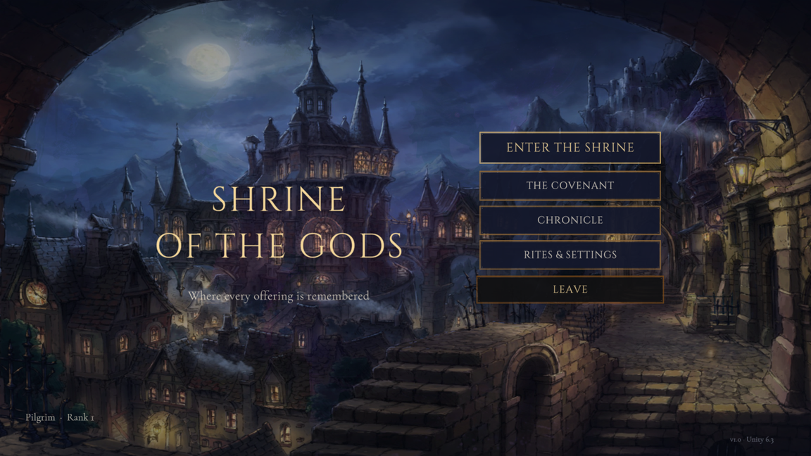
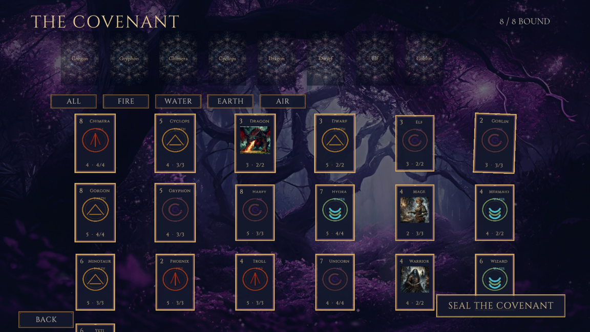
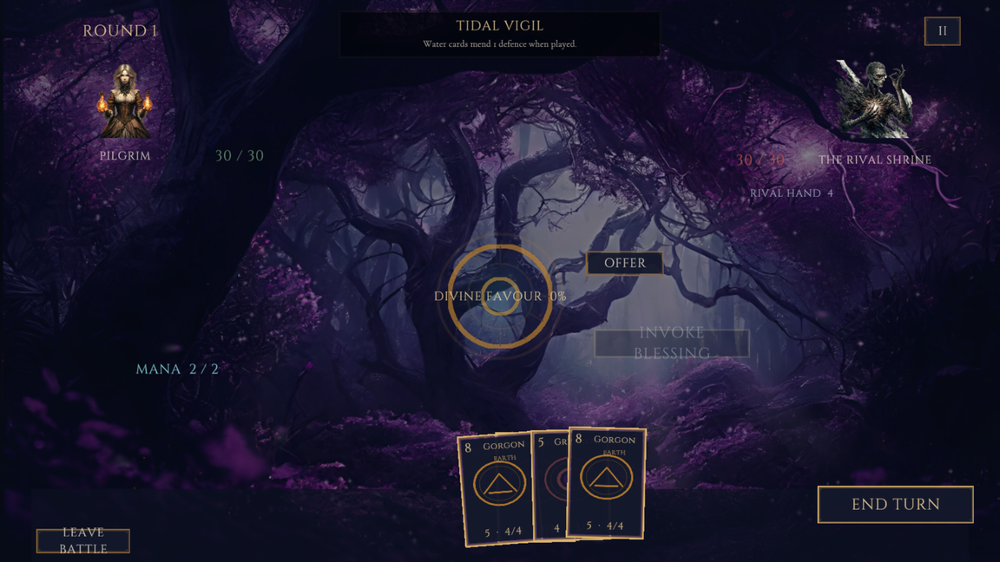

# Shrine of the Gods

**Where every offering is remembered.** A dark-fantasy card battler about omens,
divine favour and the bargains struck at a shrine between twilight and dawn.

> This is an overhaul of an early Unity prototype. The original painted art is
> preserved; the game systems, interface and code were rebuilt around it.



## Features

- **Elemental card battles** — 19 creatures across Fire, Water, Earth and Air.
  Play cards to the field, attack rival cards or the rival shrine, and use each
  element's one-time power.
- **Divine Favour** — earn favour with cards of your patron's element and by
  sacrificing cards at the altar. At 100 %, invoke a patron blessing:
  cinders, tides, ash or gale.
- **Omens** — every round changes the rules: Emberfall, Tidal Vigil, Stone Mass,
  Gale Whisper, Blood Moon or Divine Harvest.
- **Offerings** — drag a card from your hand onto the shrine to gain favour and
  draw a replacement.
- **Four patrons** — Valen the Ember Saint, the Drowned Oracle, Ale the Ash Warden
  and Jean the Skywright, each with a distinct blessing and avatar.
- **Ceremonial UI** — gilded frames, painted backdrops, drifting embers, animated
  screens, hover/press/focus states, tooltips and settings that save.
- **Consistent motion** — anticipation, impact and follow-through for every action,
  with hit stop, decaying shake, squash/stretch and a reduced-motion option.
- **Procedural audio** — ambient drone and ten UI/combat cues synthesised at runtime;
  no unlicensed samples.




## Controls

| Action | Mouse / keyboard |
|---|---|
| Navigate buttons | Mouse, `Tab` / `Shift+Tab`, arrow keys |
| Activate / confirm | Click, `Enter`, `Space` |
| Back / cancel | `Esc` |
| Inspect a card | Hover — tooltip appears after 0.35 s |
| Play a card | Click it, or drag it onto the field |
| Attack | Drag a field card onto a rival card or the rival portrait |
| Offer a card | Drag a hand card onto the central altar |
| End turn | **End Turn** button |
| Pause | `II` button or `Esc` |
| Settings | `F1` or the title-screen button |

Gamepad navigation is laid out through Unity's EventSystem but has not been
verified on a physical controller yet.

## Requirements

- Unity **6000.3.22f1** (Unity 6.3 LTS) with Windows Standalone build support.
- Windows 10/11, 1920×1080 reference resolution; minimum readable size 1280×720.
- No additional packages to install; DOTween is bundled in the repository.

## Open, build and run

```powershell
$unity = "C:\Program Files\Unity\Hub\Editor\6000.3.22f1\Editor\Unity.exe"
$project = "C:\Users\Admin\Projects\ShrineOfTheGods"

# Open in the editor
& $unity -projectPath $project

# Compile / import from the command line
& $unity -batchmode -nographics -quit -projectPath $project `
    -logFile "$env:TEMP\shrine-compile.log"

# Regenerate the scene and design assets (only needed after data changes)
& $unity -batchmode -nographics -quit -projectPath $project `
    -executeMethod Shrine.Editor.ShrineSceneBuilder.Build

# Build a Windows player
& $unity -batchmode -nographics -quit -projectPath $project `
    -buildWindows64Player "$project\Builds\ShrineOfTheGods.exe"
```

The built player starts at `Builds/ShrineOfTheGods.exe`. For windowed testing:
`ShrineOfTheGods.exe -screen-fullscreen 0 -screen-width 1600 -screen-height 900 -windowed`.

## Tests

```powershell
& $unity -batchmode -nographics -projectPath $project `
    -runTests -testPlatform EditMode `
    -testResults "$project\TestResults\editmode.xml"
& $unity -batchmode -nographics -projectPath $project `
    -runTests -testPlatform PlayMode `
    -testResults "$project\TestResults\playmode.xml"
```

Latest results: **11 EditMode** and **2 PlayMode** tests passing. Steady-state
frame allocation is 0 B; see [docs/PERFORMANCE.md](docs/PERFORMANCE.md).

## Project structure

```
Assets/_Project/
  Art/Fonts/            OFL fonts and licences
  Resources/Shrine/     Generated card, patron, omen and balance assets
  Scenes/Shrine.unity   The single game scene
  Scripts/
    Core/               Composition root, stores, screen router
    Data/               Definitions and canonical content tables
    Gameplay/           Pure battle model, AI, card instances
    UI/                 UI kit, screens, card views, procedural art
    Audio/              Procedural synthesis and sound bus
    VFX/                Screen-space feedback and pooling
    Utils/              Frame probe
    Editor/             Scene/content generator
    Tests/              EditMode and PlayMode tests
  ThirdParty/DOTween/   DOTween extension modules
```

The original scenes and scripts remain in `Assets/Scenes` and `Assets/Codes` for
reference but are not in the build settings.

## Architecture

A composition root (`ShrineApp`) creates services and screens. The battle model is
a pure C# class that raises events; `BattleScreen` binds those events to pooled
views and animations. All tuning lives in ScriptableObjects. Deterministic AI
returns actions that the view executes with delays. See
[docs/ARCHITECTURE.md](docs/ARCHITECTURE.md) for the full diagram.

## Tech stack

Unity 6.3 LTS · C# · uGUI 2.0 · TextMesh Pro · DOTween · Unity Test Framework ·
built-in render pipeline · procedurally generated audio and UI art.

## Roadmap

- Full gamepad focus parity and controller prompts.
- A real `AudioMixer` asset with named groups and music transitions.
- More patron-specific cards and a daily omen rotation.
- Card view pooling telemetry and a steady-state performance pass.
- Localisation for English/Spanish.

## Credits and licence

Original art and concept belong to the project author. All new fonts are OFL;
DOTween is used under its free licence; all new art and audio are procedural.
See [CREDITS.md](CREDITS.md). The repository does not declare a redistribution
licence for the original art, so treat it as all rights reserved.

Documentation index: [docs/00_START_HERE.md](docs/00_START_HERE.md).
