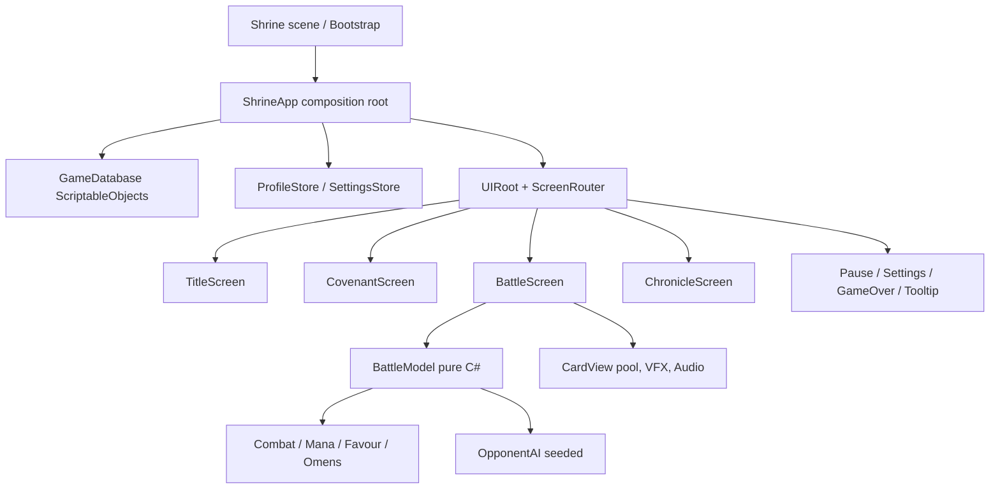

# Architecture

Target architecture for the overhaul. The old scenes remain as reference only.



## Layers
- **Data**: `CardDefinition`, `PatronDefinition`, `OmenDefinition`, `BalanceConfig`
  as ScriptableObjects. Immutable at runtime.
- **Model**: pure C# classes with events. No `UnityEngine` dependency except math
  value types. Deterministic with an injected `IRandom`.
- **Presentation**: `BattleScreen` binds model events to views; never owns rules.
- **Services**: `AudioService`, `VfxService`, `CardPool`, `SettingsStore`,
  `ProfileStore`, injected through the composition root.
- **UI**: runtime-built uGUI with a small kit (`GildedPanel`, `ShrineButton`,
  `CardView`, `StatBar`, `Tooltip`, `Modal`). No scene wiring except the root.

## State machine
`BattlePhase`: `Intro → PlayerDraw → PlayerAction → ResolvePlayer → EnemyDraw →
EnemyAction → ResolveEnemy → RoundEnd → (next round | Victory | Defeat)`.
Only the active phase accepts input. Coroutines animate; the model changes
synchronously and raises events.

## Folder map (target)
```
Assets/_Project/
  Scenes/Shrine.unity
  Scripts/
    Core/        Bootstrap, App, ScreenRouter, ServiceLocator-lite
    Data/        Definitions, BalanceConfig, database
    Gameplay/    BattleModel, cards, combat, favour, omens, AI
    UI/          Screens, kit, card views, transitions
    Audio/       Mixer service, SFX bank
    VFX/         Pooled particles, shake, damage numbers
    Utils/       Tween helpers, RNG, extensions
  Art/           Fonts, Sprites, Backgrounds, Materials
  Audio/         Music, SFX, Mixer
  Animations/    DOTween sequences are code-driven; clips only for avatars
  Prefabs/       Only reusable world/UI prefabs
  ScriptableObjects/ Cards, Patrons, Omens, Balance
  Shaders/       UI glow/vignette/fog
  Tests/EditMode, Tests/PlayMode
```
Old code moves into `Assets/_Project/Scripts/Legacy` only if still referenced; dead
systems (`FirebaseController`, SQLite plugins, login) are removed with a written reason.

## Key rules
- One composition root; no `FindObjectOfType`, no hidden singletons.
- Model events are unsubscribed on disable; views pool and reset.
- All numeric tuning lives in `BalanceConfig`, not magic numbers.
- Deterministic AI takes `IRandom`; tests seed it.
- Async work is coroutine-based (no async void); no `Thread.Sleep`.
- Every screen is closed by `ScreenRouter`; only it activates screens.

## Combat model

`BattleModel` owns every rule; views only present its events.

- **Turn flow.** Player first, then the rival. Both start on 2 mana, gain one maximum
  mana per round (cap 10) and refill on their own turn. Each draws at the start of its
  turn. The opening hand is four cards with one guaranteed affordable card, and the
  rival deploys its cheapest opening card as a **guardian** before the first turn
  (`BalanceConfig.StartingGuardians`) so the pilgrim cannot strike a naked shrine on
  turn one.
- **Playing.** A card costs its mana, enters the field and may attack the same turn.
  New cards do not have summoning sickness in this game.
- **The hero is armoured by its board.** A shrine can only be struck while the opposing
  field is empty, so clearing the board is the way to reach a life total.
- **Element cycle.** `ElementRules` is the single source of truth:
  `Fire > Air > Earth > Water > Fire`. An attacker that beats its target deals double
  damage; a defender that beats its attacker deals double retaliation.
- **Card powers.** Fire takes the omen's attack bonus. Water gains 2 defence the first
  time it strikes. Earth ignores the first damage it would take (first retaliation) and
  gains 2 defence. Air's first omened gale costs 1 less.
- **Retaliation.** Card-to-card strikes always take damage back, doubled when the
  defender has the element advantage. Earth's defence power and the omen shield apply
  before the damage lands.
- **Forecast.** `BattleScreen` predicts `EffectiveAttack`, `RetaliationDamage` and
  `HeroDamage` while a field card is dragged, so the player can see the trade, the
  kill, the reply and whether the card dies before committing.
- **AI.** `OpponentAI` returns a deterministic action list; see `docs/AI_GUIDE.md`.
